<div align="center">

# Camouflaged Object Detection in Images & Video using SINet

**EE5340 Video Analytics — Course Project 2026 · IIT Guwahati (SiSAS)**
Faculty: **Prof. Prithwijit Guha**

| Member | Roll No. |
|:--|:--|
| Akash Shukla | 264152017 |
| Abdul Quadir | 264152001 |
| Sanjeev Singh | 264152013 |

🌐 **[Project Report Webpage](https://akashshukla-github.github.io/SINet-COD-VideoAnalytics/)** &nbsp;·&nbsp;
📊 **[Presentation (PPT)](assets/ppt/SINet_COD_Presentation.pptx)** &nbsp;·&nbsp;
📓 **[All code, explained (notebook)](SINet_Complete_Code_Explained.ipynb)** &nbsp;·&nbsp;
▶️ **[Run in Colab](https://colab.research.google.com/github/akashshukla-github/SINet-COD-VideoAnalytics/blob/main/SINet_Colab_Demo.ipynb)**

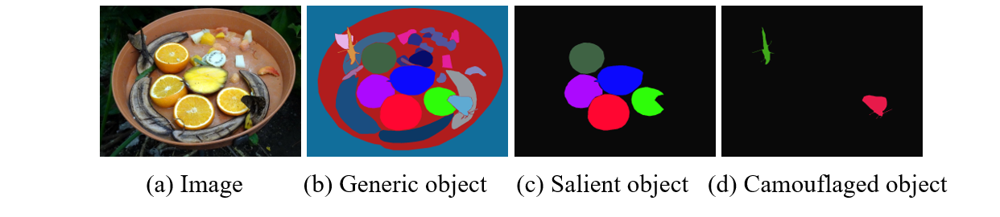

<sub><b>Figure 1.</b> (a) Image, (b) generic segmentation, (c) salient object, (d) <b>camouflaged object</b>: the butterflies blend into the bananas. Source: SINet [1].</sub>

</div>

---

## TL;DR
We study **SINet** (Search & Identification Network, Fan et al., CVPR 2020) [1], which segments objects that are hidden in their surroundings.

- We **extracted its complete workflow** from the repository diagrams and the source code, with tensor shapes and equations.
- We **verified the paper against the code** and found 3 differences.
- We **modernised the inference code** so it runs on current PyTorch.
- We **extended SINet to video** with temporal EMA smoothing, a connected-component mask and centroid tracking.

---

## Table of Contents
1. [Introduction](#1-introduction)
2. [Brief Literature Review](#2-brief-literature-review)
3. [Methodology](#3-methodology)
4. [Experimental Setup](#4-experimental-setup)
5. [Results](#5-results)
6. [Conclusion](#6-conclusion)
7. [Repository Structure & How to Run](#7-repository-structure--how-to-run)
8. [References](#8-references)
9. [Presentation and Videos](#9-presentation-and-videos)

---

## 1. Introduction

### 1.1 Motivation
Detection and segmentation models are built for objects that **stand out**. Camouflaged objects, such as a stick insect on a branch or a flatfish on sand, match their background in colour, texture and outline. The cues that Salient Object Detection relies on (contrast, distinct colour, clear boundaries) are deliberately suppressed. In **video**, camouflage is often broken only over time, through motion, which connects COD directly to Video Analytics:

> **image → frame → sequence → temporal information → motion → object → track**

### 1.2 Applications
| Medical: polyp segmentation | Agriculture: locust detection |
|:--:|:--:|
| 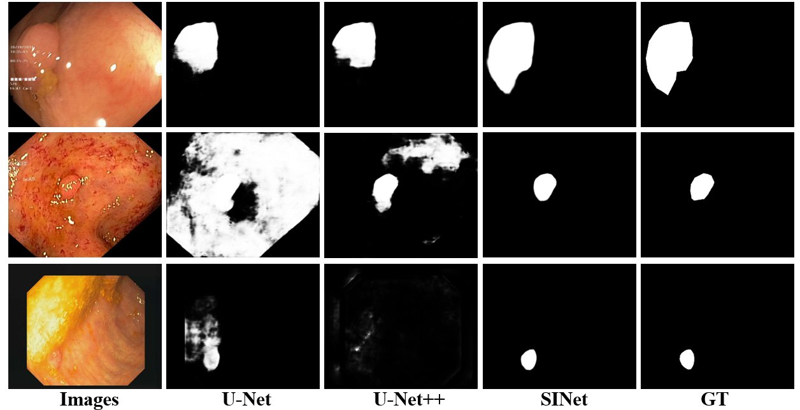 | 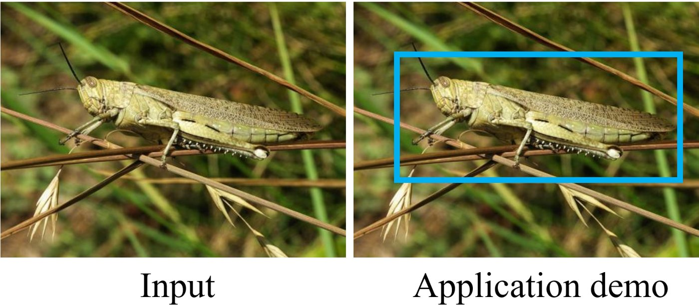 |
| **Search and rescue** | **Industrial surface-defect detection** |
| 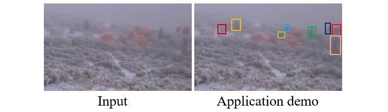 | 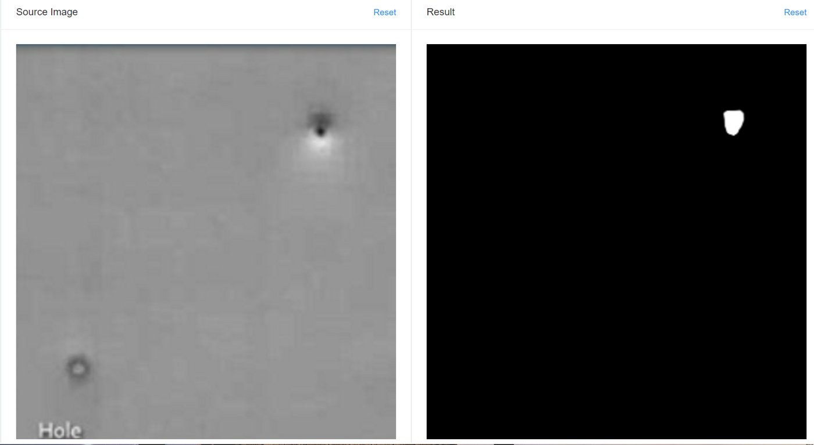 |

Other uses: wildlife monitoring, surveillance, and robot or drone perception in low-contrast natural scenes.

### 1.3 Problem Statement
Given an RGB image, predict a per-pixel camouflage map, supervised by a binary mask:

```math
I \in \mathbb{R}^{H\times W\times 3} \;\longrightarrow\; C \in [0,1]^{H\times W}, \qquad G \in \{0,1\}^{H\times W}
```

**Video extension:** for frames $\{I_t\}_{t=1}^{T}$, produce temporally stable maps $\{S_t\}$, masks $\{M_t\}$ and a centroid track $\{(x_c,y_c)_t\}$.

### 1.4 Contributions (our group)
1. **Workflow extraction:** full data flow, tensor shapes and equations reconstructed from the README diagram and `Src/SINet.py` (Fig. 2).
2. **Code-vs-paper verification:** 3 differences documented (§5.4).
3. **`code/test_images.py`:** the original `MyTest.py` relies on `scipy.misc.imsave`, which was removed from SciPy. Our replacement runs on modern PyTorch and reports MAE / IoU / $F_\beta$ with result and failure-case panels.
4. **`code/video_inference.py`:** frame-wise SINet, temporal EMA smoothing, a connected-component mask, a bounding box and a centroid track, producing `overlay.mp4` and `track.csv`.
5. **`SINet_Complete_Code_Explained.ipynb`:** the whole project in one notebook, explained cell by cell, runnable on a laptop CPU.

---

## 2. Brief Literature Review
- **Generic and salient detection.** FPN [4], Mask R-CNN [5], PSPNet [6]; and SOD models PiCANet [7], BASNet [8], CPD [9], EGNet [10]. All assume the target is visually distinct, an assumption camouflage breaks.
- **Camouflage datasets.** CHAMELEON [12] (76 images) and CAMO [13] (2,500 images, ANet baseline) were small. **COD10K** [1] has 10,000 images with dense, hierarchical annotations.
- **Building blocks of SINet.** ResNet-50 [14] backbone, RFB [15] multi-scale receptive fields, and CPD [9] partial decoder with holistic attention.
- **Later work.** SINet-V2 [2] (TPAMI 2022) and MoCA [3], which detects camouflaged animals in video through motion.

---

## 3. Methodology
SINet copies a predator: a **Search Module** finds *where* the prey might be, **Search Attention** enlarges that region, and an **Identification Module** segments *exactly what* it is.

### 3.1 Overall workflow
<p align="center">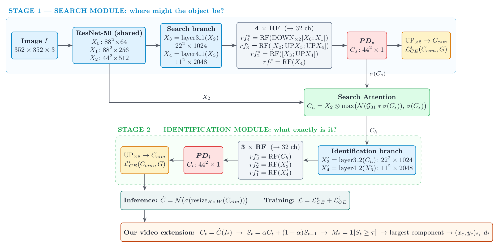</p>
<p align="center"><sub><b>Figure 2.</b> Workflow we extracted from the README figure and the code, typeset in LaTeX/TikZ (ours). Blue: backbone · grey: RF blocks · red: partial decoders · green: search attention · yellow: supervision · orange: our video extension.</sub></p>

<details>
<summary><b>Original SINet architecture figure from the authors (click)</b></summary>
<p align="center">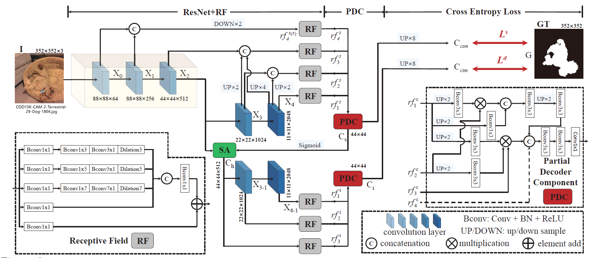</p>
<p align="center"><sub><b>Figure 3.</b> SINet framework [1]: ResNet + RF, PDC, cross-entropy loss on both stages. Insets: RF block and Partial Decoder Component.</sub></p>
</details>

### 3.2 Feature extraction (ResNet-50, two branches)
| Symbol | Layer | Size ($H\times W\times C$) | Stride | Role |
|:--:|:--|:--:|:--:|:--|
| $X_0$ | conv1 + BN + ReLU + maxpool | $88\times88\times64$ | 4 | edges, colour |
| $X_1$ | layer1 | $88\times88\times256$ | 4 | low-level texture |
| $X_2$ | layer2 | $44\times44\times512$ | 8 | parts (shared by both stages) |
| $X_3$ / $X_3'$ | `layer3_1` / `layer3_2` | $22\times22\times1024$ | 16 | object semantics |
| $X_4$ / $X_4'$ | `layer4_1` / `layer4_2` | $11\times11\times2048$ | 32 | global context |

Layers 3–4 exist **twice**: one copy for searching, one for identifying. Both copies are initialised from the same ImageNet weights and trained independently.

### 3.3 Receptive Field (RF) module
Handles tiny objects (a pipefish) and large ones (a leopard) by running 4 branches with kernels 1, 3, 5, 7 and dilations 1, 3, 5, 7. Every RF block outputs 32 channels.

```math
\begin{aligned}
b_0 &= \mathrm{Bconv}_{1\times1}(x)\\
b_n &= \mathrm{Dil}_{2n+1}\Big(\mathrm{Bconv}_{(2n+1)\times1}\big(\mathrm{Bconv}_{1\times(2n+1)}(\mathrm{Bconv}_{1\times1}(x))\big)\Big),\quad n=1,2,3\\
\mathrm{RF}(x) &= \mathrm{ReLU}\Big(\mathrm{Bconv}_{3\times3}\big([\,b_0;\,b_1;\,b_2;\,b_3\,]\big) + \mathrm{Bconv}_{1\times1}(x)\Big)
\end{aligned}
```

A $3\times3$ kernel with dilation $d$ covers a $(2d+1)\times(2d+1)$ window, so branch 3 sees $15\times15$ using only 9 weights.

### 3.4 Search Module and Partial Decoder Component (PDC)
```math
rf^s_4=\mathrm{RF}(\mathrm{DOWN}_{\times2}[X_0;X_1]),\quad
rf^s_3=\mathrm{RF}([X_2;\mathrm{UP}X_3;\mathrm{UP}^2X_4]),\quad
rf^s_2=\mathrm{RF}([X_3;\mathrm{UP}X_4]),\quad
rf^s_1=\mathrm{RF}(X_4)
```
The PDC fuses these maps, from deepest $r_1$ to shallowest $r_3$, by **multiplication**:
```math
\begin{aligned}
r_2' &= \mathrm{B}(\mathrm{UP}\,r_1)\otimes r_2, \qquad
r_3' = \mathrm{B}(\mathrm{UP}^2 r_1)\otimes \mathrm{B}(\mathrm{UP}\,r_2)\otimes r_3\\
r_2'' &= \mathrm{B}\big([\,r_2';\ \mathrm{B}(\mathrm{UP}\,r_1)\,]\big), \qquad
r_3'' = \mathrm{B}\big([\,r_3';\ \mathrm{B}(\mathrm{UP}\,r_2'');\ rf^s_4\,]\big)\\
C_s &= \mathrm{Conv}_{1\times1}\big(\mathrm{B}(r_3'')\big)\in\mathbb{R}^{44\times44\times1}
\end{aligned}
```
A pixel stays active only if **all deeper levels agree**. Deep features say *roughly here*, and shallow features add the boundary.

### 3.5 Search Attention (SA)
```math
A=\sigma(C_s),\qquad \tilde A=\mathcal{N}\big(\mathcal{G}_{31}*A\big),\qquad
\mathcal{N}(z)=\frac{z-\min z}{\max z-\min z+\epsilon},\qquad
C_h = X_2\otimes\max(\tilde A,\,A)
```
<p align="center">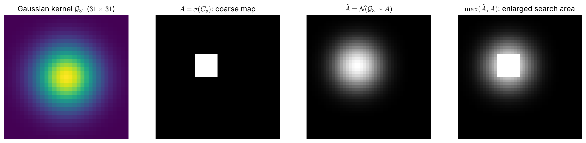</p>
<p align="center"><sub><b>Figure 4.</b> Search Attention on a toy coarse map (our notebook). The attention area above 0.5 grows from 64 to 148 pixels.</sub></p>

### 3.6 Identification Module
```math
X_3'=\mathrm{layer3\_2}(C_h),\quad X_4'=\mathrm{layer4\_2}(X_3'),\quad
C_i = PD_i\big(\mathrm{RF}(X_4'),\,\mathrm{RF}(X_3'),\,\mathrm{RF}(C_h)\big)
```

### 3.7 Loss and training
Both maps are upsampled $\times8$ and supervised with the same ground truth (deep supervision):
```math
\mathcal{L}=\mathcal{L}^{s}_{CE}(C_{csm},G)+\mathcal{L}^{i}_{CE}(C_{cim},G),\qquad
\mathcal{L}_{CE}(C,G)=-\frac{1}{N}\sum_{p}\Big[G_p\log\sigma(C_p)+(1-G_p)\log\big(1-\sigma(C_p)\big)\Big]
```
At inference only the refined map is used: $\hat C=\mathcal{N}\big(\sigma(\mathrm{resize}_{H\times W}(C_{cim}))\big)$.

### 3.8 Our extension: SINet on video
```math
\begin{aligned}
C_t &= \hat C(I_t), & S_t &= \alpha\,C_t+(1-\alpha)\,S_{t-1}\ \ (\alpha=0.6), & M_t &= \mathbf{1}[S_t\ge\tau]\ \ (\tau=0.5)\\
(x_c,y_c)_t &= \tfrac{1}{|\Omega_t|}\textstyle\sum_{(x,y)\in\Omega_t}(x,y), & d_t &= \big\|(x_c,y_c)_t-(x_c,y_c)_{t-1}\big\|_2
\end{aligned}
```
Here $\Omega_t$ is the largest 8-connected component of $M_t$. The EMA is a first-order IIR filter: a frame $k$ steps old has weight $\alpha(1-\alpha)^k$.

<p align="center">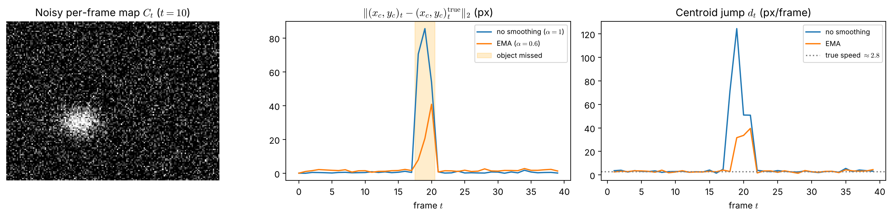</p>
<p align="center"><sub><b>Figure 5.</b> Temporal smoothing on <b>simulated</b> maps (notebook, Part 10). The detector misses the object in frames 18–20. EMA cuts the mean error from the true path from 5.72 to 3.18 px and the mean centroid jump from 10.40 to 5.40 px/frame. On normal frames it lags by about 1–2 px.</sub></p>

---

## 4. Experimental Setup

**Baselines (12, from [1]).** Generic: FPN, Mask R-CNN, PSPNet, UNet++, MSRCNN, HTC · SOD: PiCANet, BASNet, PFANet, CPD, EGNet · COD: ANet-SRM.

**Datasets**
| Dataset | Images | Train / Test | Notes |
|:--|:--:|:--:|:--|
| **COD10K** [1] | 10,000 | 6,000 / 4,000 | 5 super-classes, 69 sub-classes, dense annotations |
| CAMO [13] | 2,500 | 2,000 / 500 | 8 categories |
| CHAMELEON [12] | 76 | – / 76 | test only |

<p align="center">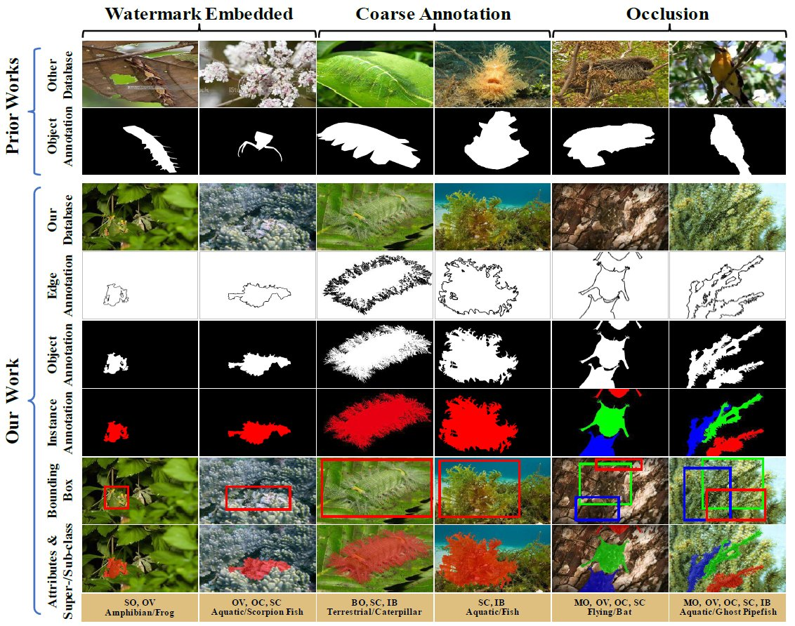</p>
<p align="center"><sub><b>Figure 6.</b> COD10K annotations: edge-, object- and instance-level masks, boxes and attributes [1].</sub></p>

**Implementation platform**
| | Original training [1] | Our runs |
|:--|:--|:--|
| Framework | PyTorch 1.3.1 + NVIDIA Apex (O1) | PyTorch 2.x + OpenCV |
| Hardware | TITAN RTX 24 GB | Google Colab T4 / laptop CPU |
| Settings | $352\times352$, Adam, lr $10^{-4}$ ($\times0.1$ every 30 epochs), batch 36, 40 epochs | released `SINet_40.pth`, $\alpha=0.6$, $\tau=0.5$ |
| Model size | $\approx 48.9$ M parameters (we counted) | — |

**Metrics.** MAE $\mathcal{M}=\frac{1}{WH}\sum_{x,y}|C(x,y)-G(x,y)|$ (lower is better). Structure-measure $S_\alpha=\alpha S_o+(1-\alpha)S_r$ with $\alpha=0.5$. Enhanced-alignment $E_\phi$. Weighted $F^w_\beta$ (higher is better).

---

## 5. Results

### 5.1 Quantitative: COD10K-test (numbers from [1])
| Model | $S_\alpha\uparrow$ | $E_\phi\uparrow$ | $F^w_\beta\uparrow$ | $\mathcal{M}\downarrow$ |
|:--|:--:|:--:|:--:|:--:|
| FPN | 0.697 | 0.691 | 0.411 | 0.075 |
| Mask R-CNN | 0.613 | 0.748 | 0.402 | 0.080 |
| PSPNet | 0.678 | 0.680 | 0.377 | 0.080 |
| UNet++ | 0.623 | 0.672 | 0.350 | 0.086 |
| PiCANet | 0.649 | 0.643 | 0.322 | 0.090 |
| MSRCNN | 0.641 | 0.706 | 0.419 | 0.073 |
| BASNet | 0.634 | 0.678 | 0.365 | 0.105 |
| PFANet | 0.636 | 0.618 | 0.286 | 0.128 |
| HTC | 0.548 | 0.520 | 0.221 | 0.088 |
| CPD | 0.747 | 0.770 | 0.508 | 0.059 |
| EGNet | 0.737 | 0.779 | 0.509 | 0.056 |
| **SINet** | **0.771** | **0.806** | **0.551** | **0.051** |

<p align="center">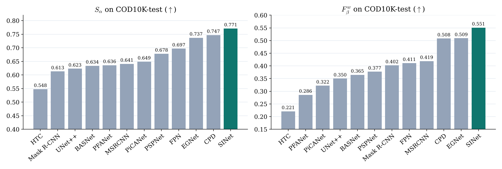</p>
<p align="center"><sub><b>Figure 7.</b> SINet is best on both metrics. The closest rivals are the SOD models CPD and EGNet.</sub></p>

**SINet on all test sets** (released model, Apex, 40 epochs [1]):
| Dataset | $S_\alpha$ | $E_\phi$ | $F^w_\beta$ | $\mathcal{M}$ |
|:--|:--:|:--:|:--:|:--:|
| CHAMELEON | 0.872 | 0.946 | 0.806 | 0.034 |
| CAMO-Test | 0.745 | 0.829 | 0.644 | 0.092 |
| COD10K-Test | 0.776 | 0.864 | 0.631 | 0.043 |

### 5.2 Qualitative
<p align="center">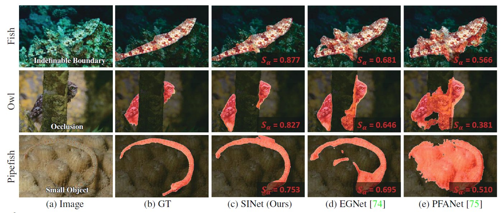</p>
<p align="center"><sub><b>Figure 8.</b> SINet vs. EGNet vs. PFANet on an indefinable boundary (fish), occlusion (owl) and a small, thin object (pipefish) [1].</sub></p>

### 5.3 Our reproduction & video results
Run `SINet_Colab_Demo.ipynb` (or `code/test_images.py` + `code/video_inference.py`). The outputs go to `results/` and appear automatically on the [project webpage](https://akashshukla-github.github.io/SINet-COD-VideoAnalytics/) (§5.3–5.4).

### 5.4 Observations
1. **Search, then re-extract:** SINet improves on CPD/EGNet by about 4 points of $F^w_\beta$ (0.551 vs 0.509) because it re-runs deep layers *after* attention.
2. **Generic detectors fail on COD:** HTC ($S_\alpha$ 0.548) and Mask R-CNN depend on objectness cues that camouflage removes.
3. **Retraining matters:** the same architecture moved from $F^w_\beta$ 0.551 to 0.631 with Apex and 40 epochs.
4. **Code vs paper (our findings):**
   - The SA Gaussian is written as $\sigma=32,\lambda=4$ in the paper, but the code builds a $31\times31$ kernel spanning $\pm4\sigma$.
   - `BasicConv2d` defines a ReLU but never applies it.
   - The PDC index range (Eq. 4) was corrected by the authors after publication.

### 5.5 Failure cases
- **Multiple objects:** an object-level map with no instance separation.
- **Thin or small parts:** the decoder works at $44\times44$ (stride 8), so legs and antennae get lost.
- **Animal-like textures:** bark or coral cause false positives.
- **Video:** a still, perfectly matched animal can vanish for many frames. EMA bridges only short gaps; motion cues [3] are needed for longer ones.

---

## 6. Conclusion
SINet's *search → identify* design (RF, PDC and Gaussian Search Attention) outperforms 12 baselines on COD10K. We explained its full workflow, verified it against the code and extended it to video.

**Future work:** optical-flow / motion cues, ConvLSTM or temporal attention, multi-object tracking (Kalman filter + Hungarian matching), and lightweight backbones for robots and drones.

---

## 7. Repository Structure & How to Run
```
├── index.html                           # Project report webpage (self-contained: images + MathJax embedded)
├── config.js                            # ← paste your YouTube/Drive video links here
├── SINet_Complete_Code_Explained.ipynb  # ALL project code in one notebook, explained (runs on CPU)
├── SINet_Colab_Demo.ipynb               # One-click Colab: weights → image results → video results
├── assets/
│   ├── img/                             # Figures (ours + from the SINet repo, credited)
│   ├── js/tex-svg.js                    # MathJax (LaTeX rendering)
│   └── ppt/SINet_COD_Presentation.pptx
├── results/                             # Our outputs (shown automatically on the webpage)
└── code/
    ├── Src/                             # Original SINet model (Fan et al.)
    ├── EvaluationTool/                  # Original MATLAB evaluation toolbox
    ├── MyTrain.py, MyTest.py            # Original scripts
    ├── test_images.py                   # OURS: modern inference + metrics
    └── video_inference.py               # OURS: video extension
```

**Quick start (Colab, free GPU):** open the Colab link above → Runtime → T4 GPU → Run all.

**Local:**
```bash
cd code
pip install torch torchvision opencv-python numpy scipy
# download SINet_40.pth and the test set from https://github.com/DengPingFan/SINet#22-usage
python test_images.py --model_path SINet_40.pth --data_root ./Dataset/TestDataset --dataset COD10K --limit 300
python video_inference.py --video input.mp4 --model_path SINet_40.pth --out_dir ../results/video
```

---

## 8. References
1. D.-P. Fan, G.-P. Ji, G. Sun, M.-M. Cheng, J. Shen, L. Shao. *Camouflaged Object Detection.* CVPR 2020. [Code](https://github.com/DengPingFan/SINet)
2. D.-P. Fan, G.-P. Ji, M.-M. Cheng, L. Shao. *Concealed Object Detection.* IEEE TPAMI 2022 (SINet-V2).
3. H. Lamdouar, C. Yang, W. Xie, A. Zisserman. *Betrayed by Motion: Camouflaged Object Discovery via Motion Segmentation.* ACCV 2020.
4. T.-Y. Lin et al. *Feature Pyramid Networks for Object Detection.* CVPR 2017.
5. K. He, G. Gkioxari, P. Dollár, R. Girshick. *Mask R-CNN.* ICCV 2017.
6. H. Zhao et al. *Pyramid Scene Parsing Network.* CVPR 2017.
7. N. Liu, J. Han, M.-H. Yang. *PiCANet.* CVPR 2018.
8. X. Qin et al. *BASNet: Boundary-Aware Salient Object Detection.* CVPR 2019.
9. Z. Wu, L. Su, Q. Huang. *Cascaded Partial Decoder for Fast and Accurate Salient Object Detection.* CVPR 2019.
10. J.-X. Zhao et al. *EGNet: Edge Guidance Network for Salient Object Detection.* ICCV 2019.
11. M. Stevens, S. Merilaita. *Animal Camouflage: Current Issues and New Perspectives.* Phil. Trans. R. Soc. B, 2009.
12. P. Skurowski et al. *Animal Camouflage Analysis: CHAMELEON Database.* 2018.
13. T.-N. Le et al. *Anabranch Network for Camouflaged Object Segmentation.* CVIU 2019 (CAMO).
14. K. He, X. Zhang, S. Ren, J. Sun. *Deep Residual Learning for Image Recognition.* CVPR 2016.
15. S. Liu, D. Huang, Y. Wang. *Receptive Field Block Net for Accurate and Fast Object Detection.* ECCV 2018.

## 9. Presentation and Videos
- **PPT:** [`assets/ppt/SINet_COD_Presentation.pptx`](assets/ppt/SINet_COD_Presentation.pptx)
- **Video demonstration and PPT screen recording:** embedded in Section 9 of the [webpage](https://akashshukla-github.github.io/SINet-COD-VideoAnalytics/#sec-video)

---

### Credits & License
The SINet model code (`code/Src`, `MyTrain.py`, `MyTest.py`), the evaluation toolbox and the figures marked [1] are by Fan et al. ([github.com/DengPingFan/SINet](https://github.com/DengPingFan/SINet)). They are reused for academic, non-commercial purposes; see [`LICENSE_SINet.txt`](LICENSE_SINet.txt). Our additions: `test_images.py`, `video_inference.py`, both notebooks, Figs. 2, 4, 5 and 7, the webpage and the PPT.

```bibtex
@inproceedings{fan2020Camouflage,
  title={Camouflaged Object Detection},
  author={Fan, Deng-Ping and Ji, Ge-Peng and Sun, Guolei and Cheng, Ming-Ming and Shen, Jianbing and Shao, Ling},
  booktitle={IEEE CVPR}, year={2020}
}
```
